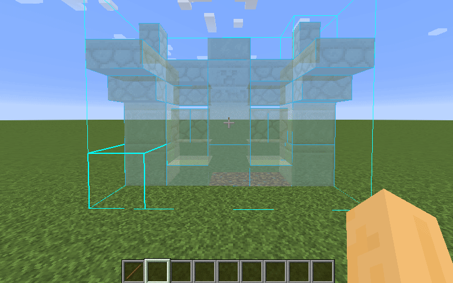

# Forgematica Printer – RS Refill Fork

Unofficial NeoForge port of [Litematica Printer](https://github.com/aleksilassila/litematica-printer), with an added **RS Refill** subsystem that automatically pulls missing blocks from a Refined Storage network while printing.

> Derived from [ThinkingStudios/ForgematicaPrinter](https://github.com/ThinkingStudios/ForgematicaPrinter) → [TexTrue/ForgematicaPrinter](https://github.com/TexTrue/ForgematicaPrinter) → [aleksilassila/litematica-printer](https://github.com/aleksilassila/litematica-printer).

The base printer auto-places blocks from schematics. This fork keeps all upstream behaviour intact and adds automatic refill from Refined Storage.

## What this fork adds: RS Refill

While the printer is running and your inventory lacks a required block, this fork opens an RS terminal and pulls the exact item by UUID into your backpack — **without any compile-time dependency on Refined Storage**.

| Behaviour | Detail |
|---|---|
| **Scan order** | Main hand → Offhand → Backpack → Curios slots (hands win when already holding the block) |
| **Extraction** | Opens RS terminal via native packet path; pulls items by UUID straight into backpack |
| **Already have it** | If the stack is already in the backpack, the network is never opened |
| **Backpack full** | Surplus blocks are returned to RS to free slots. Only the main backpack is touched; hotbar is left alone |
| **Fluids** | Fluid placements are skipped outright — no terminal open/close around water/lava |
| **Missing block backoff** | Blocks absent from RS use exponential backoff: `5 → 10 → 20 → 40 → cap` ticks; other printable blocks keep going during cooldown |

### Safety fixes in the refill loop

- **Inventory open → placement pauses**, preventing wrong-block placement from hotbar swaps mid-print
- **30-second return guard**: blocks pulled within the last 30 seconds are never auto-returned (stops throw-out/pull-back loops)
- **RS sync awaited**: item-list sync is awaited before any absence decision (fixes false "not in network" on first tick)

### In-game config

| Key | Default | Notes |
|---|---|---|
| `rsRefill` | `true` | Master switch for refill subsystem |
| `rsAbsentCooldown` | `60 s` | Cap for exponential-backoff; adjustable live in-game |

## How RS Refill works (no compile-time RS dependency)

- **100% reflection.** All RS classes accessed via `Class.forName` + method handles. Compiles cleanly in Yarn/Mojmap dev environments; resolves names at runtime on server mappings.
- **Self-discovering curios probe.** Walks every no-arg method on the handler, uses whichever returns a `Map`. Slot-group names/counts read dynamically from map keys. No code changes needed when swapping curio configs in modpacks.
- **Tick-driven state machine.** Open terminal → await sync → extract → await arrival → close GUI → resume printing. One central tick listener owns the whole lifecycle.
- **Diagnostic logging.** Every refill step emits structured log lines (`[RSRefill]` prefix) for troubleshooting.

RS Refill subsystem was developed with AI assistance and is considered experimental.

## How To Use

- Toggle printing: `CAPS_LOCK` (default)
- Printer settings: `M + C` → *Generic* tab → bottom section
- Print hotkey: `V` (hold to print, works regardless of toggle state)
- RS Refill: enable via in-game config screen (`rsRefill`), ensure player has access to an RS Grid/Interface/Crafting Terminal

## Issues

Report problems with **this fork** at this repository's [Issues](../../issues). Do not bother maruohon (Litematica author) or upstream ForgematicaPrinter maintainers about RS Refill behaviour.

When filing a bug, include:

- Minecraft version
- ForgematicaPrinter-RSRefill version (e.g. `0.1.1-rsrefill`)
- Refined Storage version
- Steps to reproduce + `latest.log` excerpt (look for `[RSRefill]` lines)

## Known Limitations

Retained from upstream (RS Refill only changes block sourcing, not placement geometry):

- Placing liquids is skipped (printing *inside* liquids works)
- `printInAir` / unsupported free-air placement remains out of scope
- Rail placement is heuristic; rare missed rails are intentional
- Auto-excavation and correcting preexisting misplaced blocks are **not** goals of this mod

Additionally, fluid entries in schematics no longer trigger terminal chatter (skipped at refill layer).

## License

**AGPL-3.0-only.** See [LICENSE](LICENSE) for full text.

| | |
|---|---|
| Original Litematica Printer | © aleksilassila |
| ForgematicaPrinter (Forge port) | © 2022–2025 TexTrue |
| NeoForge branch (`ThinkingStudios`) | © ThinkingStudios contributors |
| RS Refill additions in this fork | © 2026 terist258 |

Every binary release (`*.jar`) must be accompanied by corresponding source code. Each release tag pins the exact source used to build that jar.

## Disclaimer

Not affiliated with Mojang AB. Minecraft is a trademark of Mojang AB. Not affiliated with Refined Storage or Litematica projects; RS interaction is implemented entirely via reflection.
